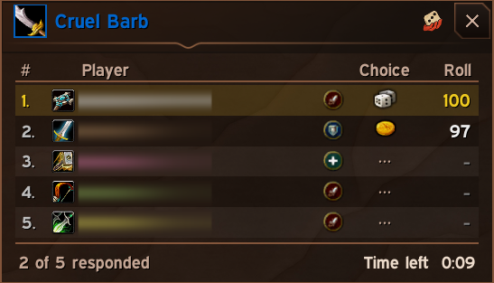
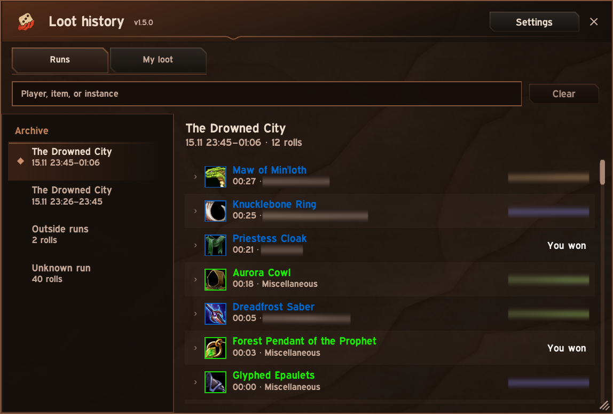
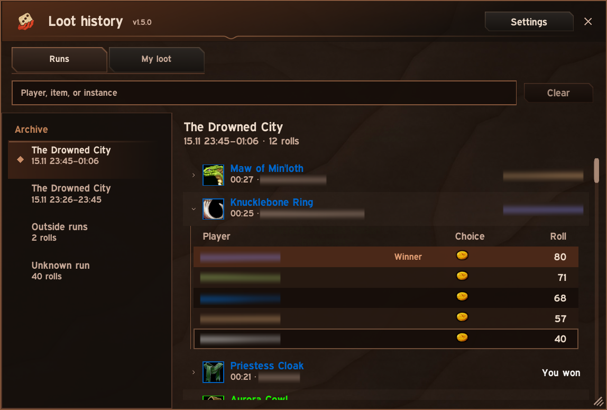
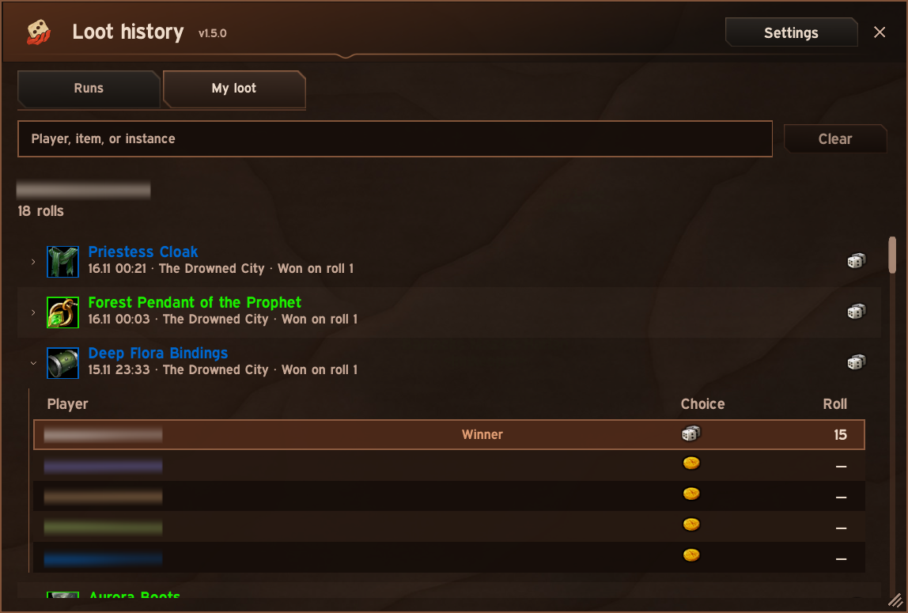
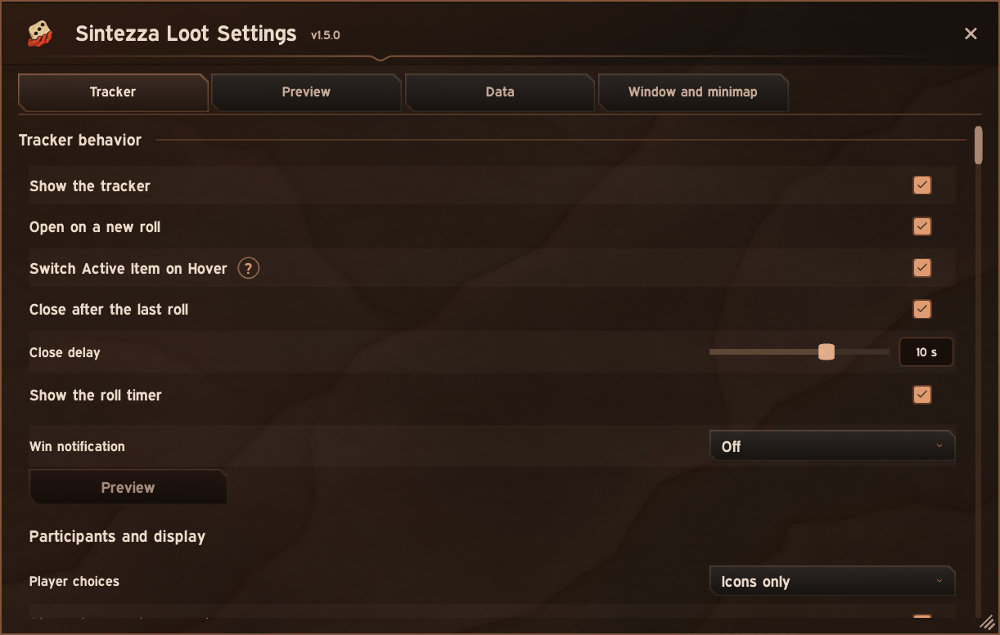

# Sintezza Loot

| CurseForge field | Value |
| --- | --- |
| Game | World of Warcraft |
| Class | Addons |
| Flavor and version | Forever 1.60.1 |
| Main category | Bags & Inventory |
| Additional categories | Data Export |
| CurseForge relations | Sintezza Theme (Required Dependency) |
| Project license | MIT. See the repository for third-party notices. |

## Summary

Track group loot rolls, search dungeon loot history, and see your own wins in WoW Forever.

## Description

Sintezza Loot tracks group and raid loot rolls in WoW Forever. Follow rolls as they happen and look up who won after the run.

### Follow a loot roll

Simulated group roll. The tracker shows responses, roll values, and time left.

Try the tracker with `/sloot test`. Simulated rolls stay out of the archive.

### Find a roll in the dungeon archive

Open `/sloot history` or click the minimap dice. Search by instance, item, or player. Rolls made outside an instance have their own list.

The run archive lists dropped items and their winners for each instance visit.

Expand a loot row to see each player’s choice and roll, with the confirmed winner marked.

### Find the items you won

My loot lists your wins and shows how many recorded rolls it took to win each item.

### Set up the tracker and back up your history

Choose when the tracker opens and closes, what it displays, and which win notification appears.

Open `/sloot` for settings. The archive keeps recording while the tracker is hidden. In **Data**, you can export or import CSV. Use **Window and minimap** to move the tracker or change the Sintezza skin setting for Blizzard’s loot roll popup. The skin is on by default for new profiles.

### Appearance

**Requires [Sintezza Theme](https://github.com/ArtefactoO/Sintezza_Theme).** Open `/stheme` to change the color scheme, button styles, background, and fonts across your Sintezza addons.

### Requirements

If you also have [Clear Loot](https://www.curseforge.com/wow/addons/clearloot), enable one tracker to avoid duplicate roll windows.

<!-- Changelog field -->

### Changelog

[View the release history on GitHub](https://github.com/ArtefactoO/Sintezza_Loot/blob/main/CHANGELOG.md).

Source, installation details, and credits are available on [GitHub](https://github.com/ArtefactoO/Sintezza_Loot).
