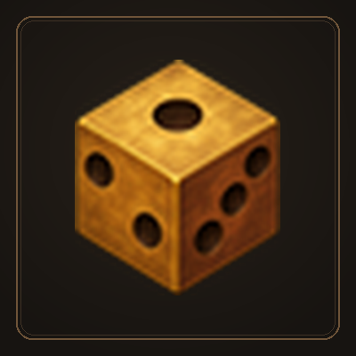
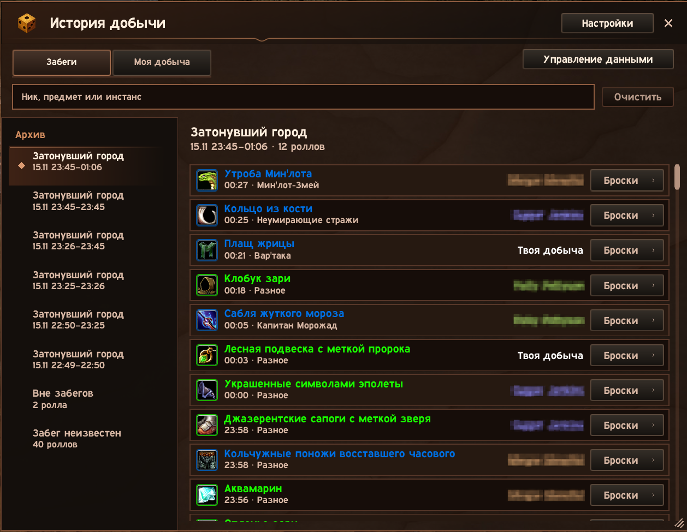
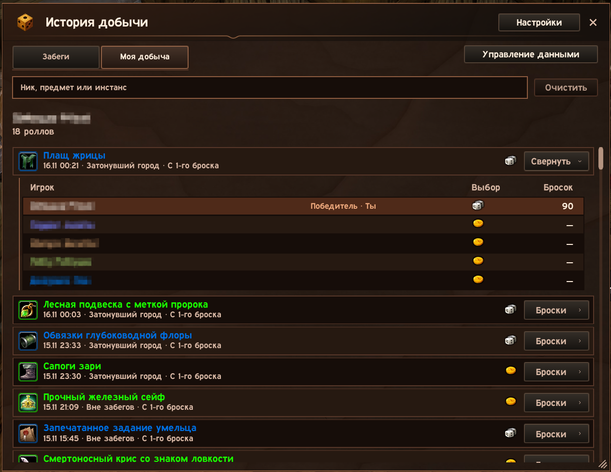
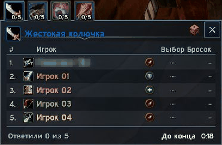

# Sintezza Loot

Sintezza Loot tracks group and raid loot in World of Warcraft Forever 1.60.1. See each player's choice, roll, and the confirmed winner. Search the archive by instance, item, or player, and find your own wins under **My loot**.

Install and enable **[Sintezza Theme](https://github.com/ArtefactoO/Sintezza_Theme)** alongside Loot. It supplies the shared windows, controls, and Russian or English interface. Change the language in `/stheme` and reload the UI. If Clear Loot is also loaded, Sintezza Loot reports the conflict in chat once and keeps tracking rolls. Enable one tracker if you want a single roll window.

## Tracker and archive

- **Tracker.** Show the remaining roll time, participant choices, and roll results. Choose the Sintezza or Blizzard win banner, both, or neither. History continues recording while the tracker window is disabled.
- **Runs.** Inspect current and archived runs. Winners are colored by class when the class is confirmed. Earlier records without run information appear under Unknown run.
- **My loot.** See your won items from group rolls. For items tracked since version 1.3.0, the series counter shows which recorded roll won the item. A series restarts after a win and survives pruning of its earlier entries.
- **Data management.** Review run, roll, and win counts. Copy all data or a selected section as CSV. Import previews changes and skips duplicates. Memory measurement and confirmed clearing are available under Maintenance.

The archive keeps the latest 400 completed rolls and up to 40 archived runs without rolls. The current run is tracked separately for each character. A run can remain open through a temporary exit. If the client withholds completion details, Loot closes the run at the next confirmed transition.

## Commands

| Command | Action |
| --- | --- |
| `/sloot` | Open settings |
| `/sloot history` | Open history. The minimap dice button opens the same window |
| `/sloot move` | Position the tracker |
| `/sloot lock` / `/sloot unlock` | Lock or unlock its position |
| `/sloot test` / `/sloot testmulti` / `/sloot testraid` | Simulate one item, four items, or a 40-player raid roll |
| `/sloot stop` | End the simulation |

The settings preview also offers group size, item count, and roll timing. Simulations display in the regular tracker and are excluded from stored history.

## Gallery

## License and credits

Sintezza Loot is distributed under the MIT license. The roll tracker and parts of its UI incorporate adaptations of Clear Loot 0.1.6 by xray33 (imxray33 on CurseForge). The run archive, My loot, and rolls-to-win counter are Sintezza features. [MIT license](LICENSE) · [Clear Loot](https://www.curseforge.com/wow/addons/clearloot) · [Changelog](CHANGELOG.md)

## На русском

Sintezza Loot показывает выбор участников, броски и победителя группового розыгрыша в WoW Forever 1.60.1. Установи и включи **Sintezza Theme**. Язык выбирается в `/stheme` и применяется после перезагрузки интерфейса. Если включен Clear Loot, Sintezza Loot один раз предупредит о конфликте и продолжит запись.

- **Трекер** показывает время розыгрыша и участников. Можно выбрать плашку победы Sintezza, Blizzard, обе или выключить обе. История записывается и со скрытым трекером.
- **История** группирует розыгрыши по заходам. Поиск работает по инстансу, предмету и нику. При подтвержденном классе имя победителя окрашивается в его цвет.
- **Моя добыча** показывает выигранные предметы текущего персонажа. Для записей с версии 1.3.0 указано, на какой попытке в серии удалось выиграть предмет. После победы начинается новая серия.
- **Управление данными** показывает счетчики заходов, розыгрышей и побед. CSV поддерживает предварительную проверку импорта и пропуск дубликатов. В «Обслуживании» доступны замер памяти и очистка с подтверждением.

`/sloot` открывает настройки, `/sloot history` — историю, `/sloot move` — режим перемещения трекера. Команды `/sloot test`, `/sloot testmulti` и `/sloot testraid` запускают предпросмотр, `/sloot stop` его завершает. Тесты исключаются из истории.

В трекере использованы адаптации кода Clear Loot. [Лицензия MIT](LICENSE) · [История изменений](CHANGELOG.md)

[CurseForge listing fields](CURSEFORGE.md)
