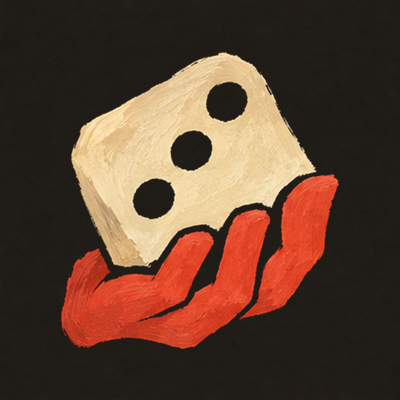
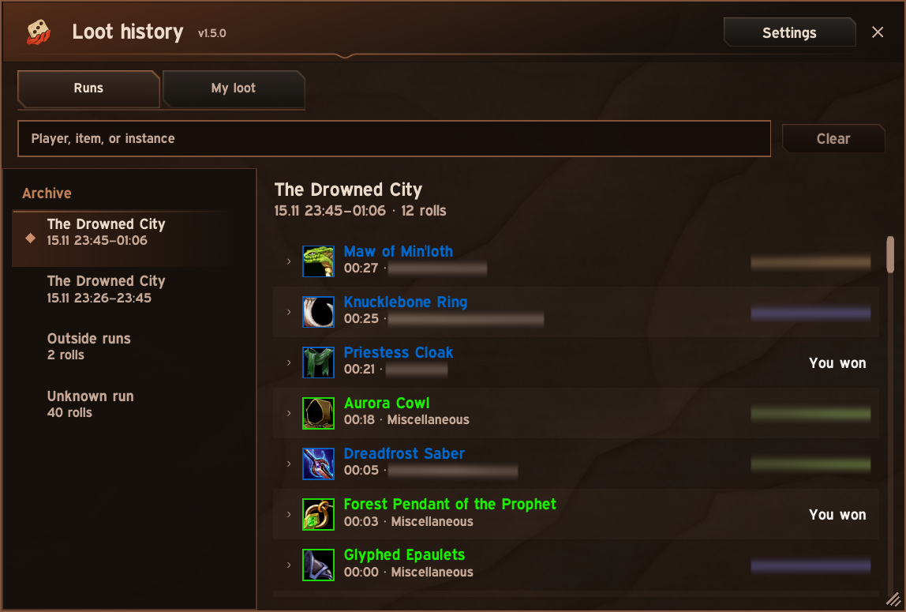
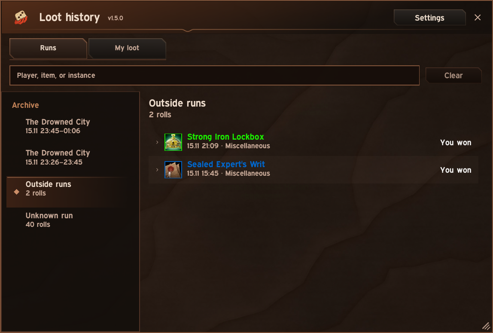
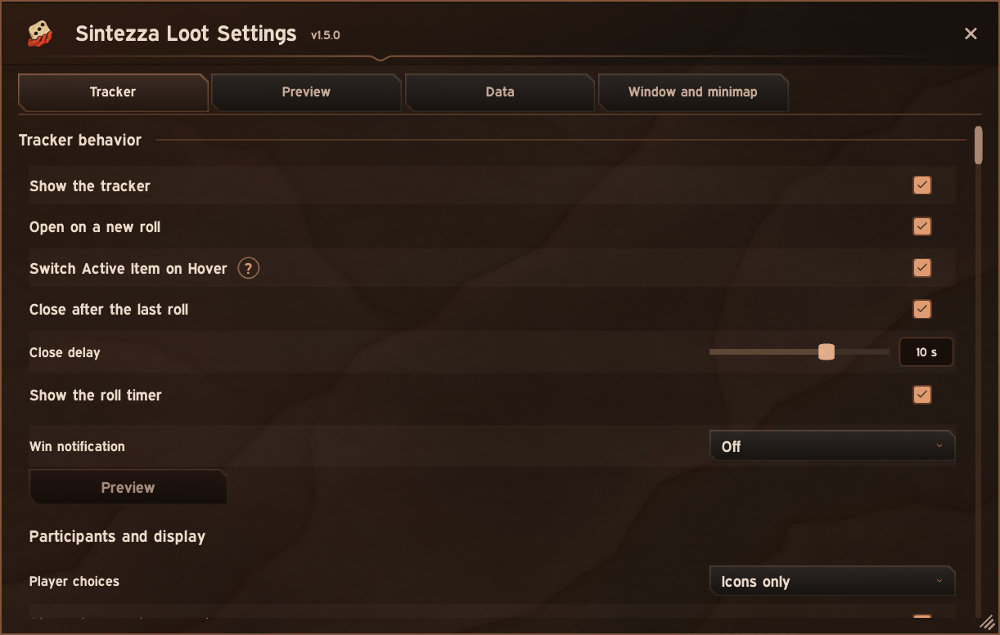
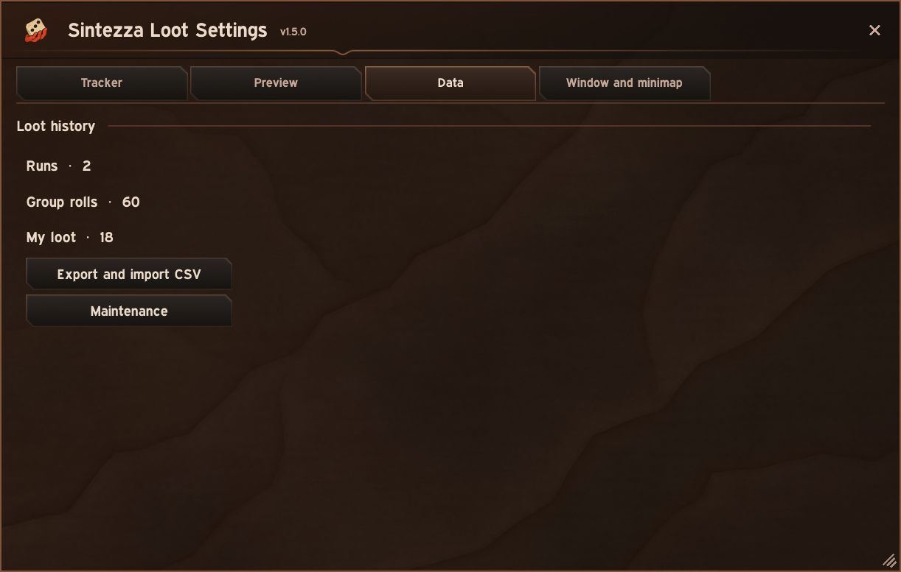
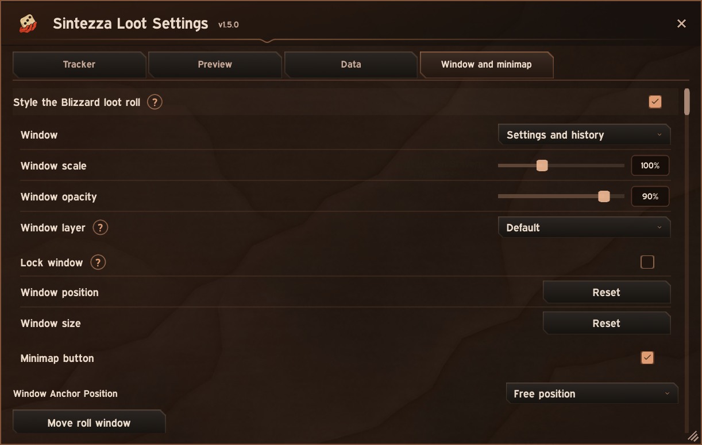

# Sintezza Loot

Sintezza Loot tracks group and raid loot in World of Warcraft Forever 1.60.1. See each player's choice, roll, and the confirmed winner. Search the archive by instance, item, or player, and find your own wins under **My loot**.

Install and enable **[Sintezza Theme](https://github.com/ArtefactoO/Sintezza_Theme)** alongside Loot. It supplies the shared windows, controls, and Russian or English interface. Change the language in `/stheme` and reload the UI. If Clear Loot is also loaded, Sintezza Loot reports the conflict in chat once and keeps tracking rolls. Enable one tracker if you want a single roll window.

## Tracker and archive

- **Tracker.** Show the remaining roll time, participant choices, and roll results. Closing a roll hides its tab and preserves tracking. Dismissed rolls identified in Blizzard's loot history stay hidden after a UI reload. Choose the Sintezza or Blizzard win banner, both, or neither. **Preview** shows the selected notifications with a sample item. History continues recording while the tracker window is disabled.
- **Blizzard roll popup.** New profiles enable the Sintezza skin by default. To change it, toggle **Style the Blizzard loot roll** under **Window and minimap** and reload. The skin requires Sintezza Theme 1.5.1 or later. Update to Theme 1.5.2 for the same stone background as other Sintezza windows. The skin takes priority over the **Loot Roll Popups** style in current versions of EllesmereUI. Item names and outlines show item quality, and the buttons use the game's roll actions.
- **Runs.** Inspect current and archived runs. Winners are colored by class when the class is confirmed. Earlier records without run information appear under Unknown run.
- **My loot.** See your won items from group rolls. For items tracked since version 1.3.0, the series counter shows which recorded roll won the item. A series restarts after a win and survives pruning of its earlier entries.
- **Data management.** Review run, roll, and win counts. Copy all data or a selected section as CSV. Import previews changes and skips duplicates. Memory measurement and confirmed clearing are available under Maintenance.

The archive keeps the latest 400 completed rolls and their runs. A run is saved only after its first recorded roll; older empty runs are removed on load. Unfinished runs continue after temporary exits and corpse runs without a time limit. Successful resets, another instance or difficulty, leaving the group, or a new challenge separate runs.

After confirmed completion, trash loot stays in the same run until you leave. Re-entering starts another run. A UI reload while still inside preserves the run, and delayed roll results keep the run where the roll began. Completion uses explicit completion events, a valid completed lock snapshot, or confirmed kills of every boss in an available journal list; the last listed boss alone is insufficient.

When available, a changed saved-instance ID or a complete lock-prompt snapshot showing a previously killed boss alive separates the current visit. A late reply moves only that visit's recorded rolls and boss kills; earlier visits stay intact. Missing, secret, ambiguous or zero-length API data is ignored. Equal progress does not prove that a copy is unchanged. If the client supplies no distinguishing evidence, use `/sloot newrun` before the next roll to separate the history manually. The command does not reset the dungeon, and earlier records are not moved. NPC GUIDs and elapsed time are not used to infer a reset.

Click a loot row to expand its participants. A small shared Theme arrow shows whether it is open. Your character has a thin outline, with the same appearance whether you win or lose.

## Commands

| Command | Action |
| --- | --- |
| `/sloot` | Open settings |
| `/sloot history` | Open history. The minimap dice button opens the same window |
| `/sloot newrun` | Start a new history run without resetting the instance |
| `/sloot move` | Position the tracker |
| `/sloot lock` / `/sloot unlock` | Lock or unlock its position |
| `/sloot test` / `/sloot testmulti` / `/sloot testraid` | Simulate one item, four items, or a 40-player raid roll |
| `/sloot stop` | End the simulation |

The settings preview also offers group size, item count, and roll timing. Simulations display in the regular tracker and are excluded from stored history.

Open **Settings** from the history header to show a separate window. Use its **Data** tab to manage loot history.

## Gallery

Simulated group roll. The tracker shows responses, roll values, and time left.

The run archive lists dropped items and their winners for each instance visit.

Expand a loot row to see each player’s choice and roll, with the confirmed winner marked.

Outside runs keeps group rolls that happened away from an instance.

My loot lists your wins and shows how many recorded rolls it took to win each item.

Choose when the tracker opens and closes, what it displays, and which win notification appears.

The Data tab shows archive counts and opens CSV import, export, and maintenance.

Set window scale and opacity, position the tracker, or enable the optional Blizzard loot roll skin.

## License and credits

Inspired by [Clear Loot](https://www.curseforge.com/wow/addons/clearloot) by xray33. [MIT License and code credits](LICENSE) · [Changelog](CHANGELOG.md)

[CurseForge listing fields](CURSEFORGE.md)
